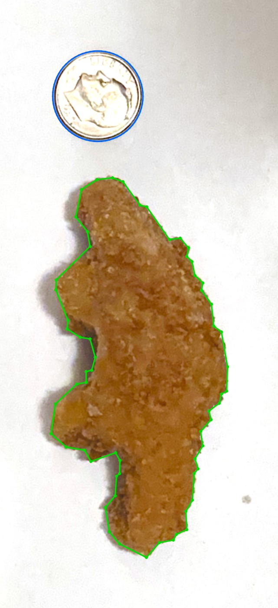
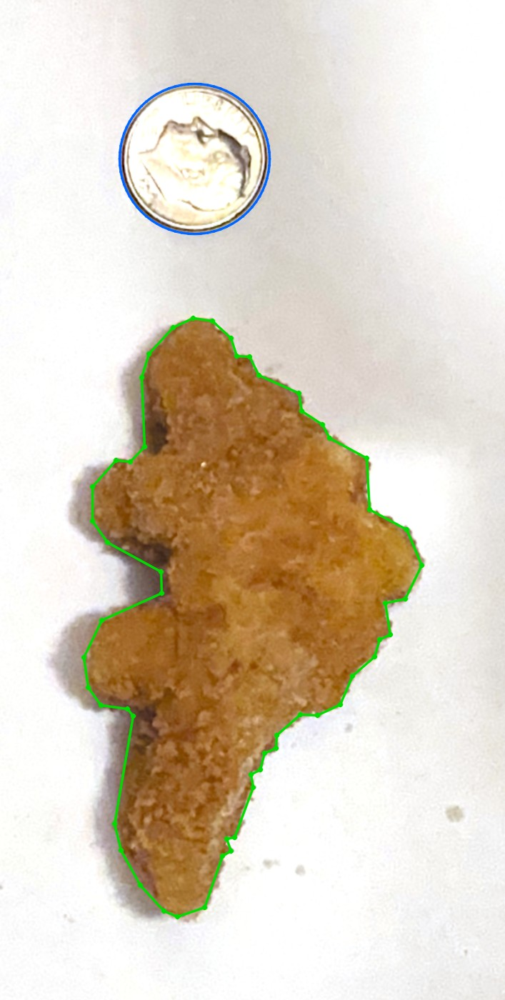
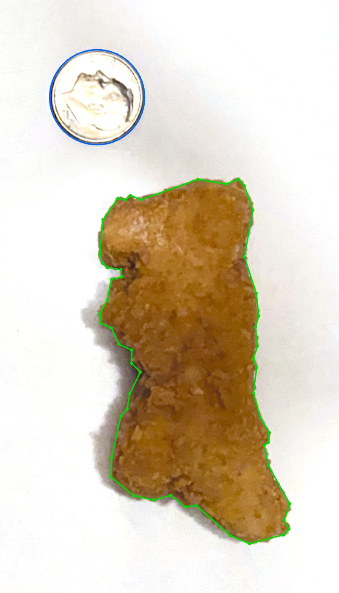
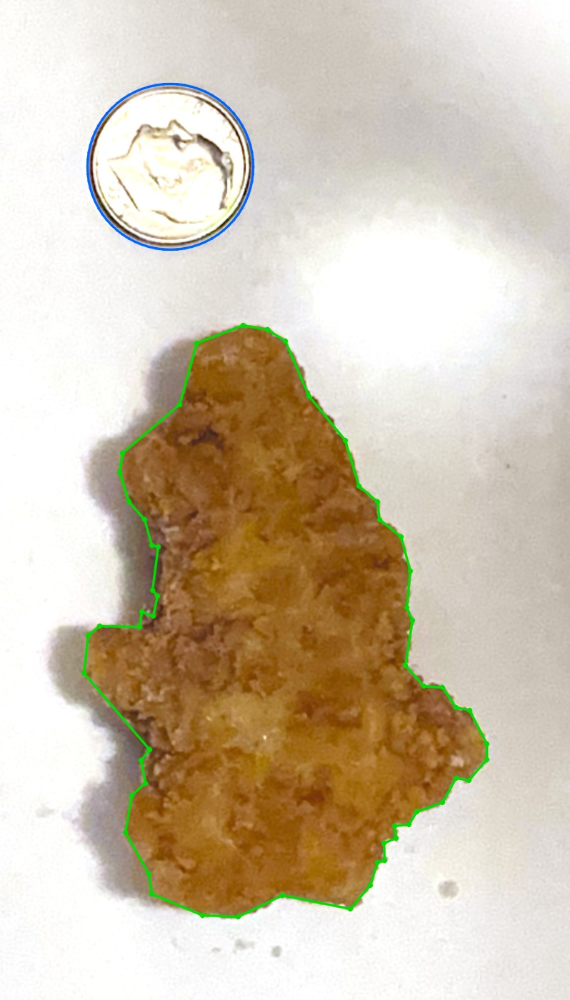

# DinoDense

Tool to help a user fit as many dino-nuggets onto a plate as possible, maximizing dino-density.  This will assist hungry users in nugget placement so that they can microwave as many dino-nuggets as possible in one go. 

The repo also serves as an open database of dino-nugget outlines (`data/shapes/`).

## The Shapes

There are four dino-nugget shapes. The names are a best guess, since none are officially published. Each outline is a polygon in real-life millimeters, extracted from a scan of one frozen nugget lying next to a dime, which gives the scale. Click an image to see it full size: the blue circle is the dime, and the green polygon is exactly what is saved.

| | Ankylosaurus | Stegosaurus | T-Rex | Triceratops |
|:---:|:---:|:---:|:---:|:---:|
| | [](data/overlays/ankylosaurus.jpg) | [](data/overlays/stegosaurus.jpg) | [](data/overlays/trex.jpg) | [](data/overlays/triceratops.jpg) |
| **Size** | 35.0 × 75.2 mm | 40.3 × 71.3 mm | 36.0 × 69.0 mm | 43.6 × 64.1 mm |
| **Area** | 1602 mm² | 1576 mm² | 1692 mm² | 1686 mm² |
| **Points** | 62 | 56 | 53 | 57 |
| **Shape file** | [ankylosaurus.json](data/shapes/ankylosaurus.json) | [stegosaurus.json](data/shapes/stegosaurus.json) | [trex.json](data/shapes/trex.json) | [triceratops.json](data/shapes/triceratops.json) |

Size is the width × height of the outline as it was scanned.

## Extracting a Shape

Shapes are extracted from scans in `data/scans/` by a small Python tool. It finds the dime to get the scale, finds the nugget, simplifies its outline to a polygon, and saves the polygon and a picture of what it found to check by eye.

```
python -m venv .venv
.venv\Scripts\python -m pip install -r tools\extract\requirements.txt
.venv\Scripts\python tools\extract\nugget_extractor.py data\scans\trex.jpg
```

For how scans are taken, how the tool works, and the shape file format, see [docs/nugget-extraction.md](docs/nugget-extraction.md).

## Repository Layout

- `data/shapes/` - one JSON polygon per nugget shape
- `data/scans/` - the original scans the shapes were extracted from
- `data/overlays/` - the picture of each extraction, to check it by eye
- `tools/extract/` - the Python tool that turns a scan into a shape
- `tests/` - tests for the extraction tool
- `docs/` - detailed documentation
- `src/` - the packing app (not started yet)

## License

MIT
